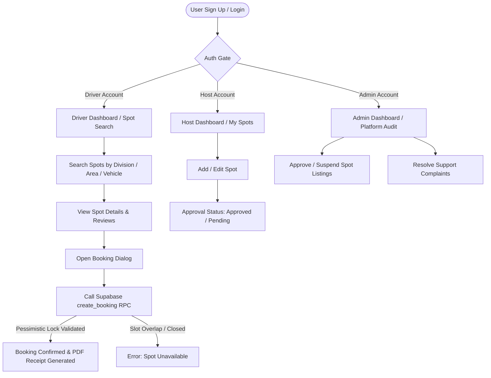

# ParkLagbee - Technical Documentation

## Executive Overview
**ParkLagbee** is a comprehensive Parking Space Rental and Booking Platform built for Bangladesh. It enables drivers to search, reserve, and pay for parking spots, allows property owners (hosts) to monetize unused parking spaces, and gives administrators complete platform oversight.

---

## 1. Directory Structure & Codebase Locations

The codebase is structured as a **Flutter Client Application** backed by a serverless **Supabase (PostgreSQL) Backend Infrastructure**.

| Component | Absolute Path / Location | Primary Responsibilities |
| :--- | :--- | :--- |
| **Frontend Mobile & Multiplatform App** | [`lib/`](file:///C:/Users/hp/AndroidStudioProjects/parkLagbee/lib) | Flutter application UI, screens, widgets, state/repository handlers, and core services. |
| **Backend & Database Infrastructure** | [`supabase/migrations/`](file:///C:/Users/hp/AndroidStudioProjects/parkLagbee/supabase/migrations) | PostgreSQL schema, Row-Level Security (RLS) policies, triggers, storage buckets, and PL/pgSQL RPC booking engine. |
| **Android Native Project** | [`android/`](file:///C:/Users/hp/AndroidStudioProjects/parkLagbee/android) | Gradle configurations, Gradle wrapper, Android manifest, and native build settings. |
| **iOS Native Project** | [`ios/`](file:///C:/Users/hp/AndroidStudioProjects/parkLagbee/ios) | Xcode project configurations, Runner runner target, Info.plist, and iOS build files. |
| **Web & Desktop Targets** | [`web/`](file:///C:/Users/hp/AndroidStudioProjects/parkLagbee/web), `windows/`, `macos/`, `linux/` | Multi-platform build wrappers for web browsers and desktop platforms. |
| **Dependencies Configuration** | [`pubspec.yaml`](file:///C:/Users/hp/AndroidStudioProjects/parkLagbee/pubspec.yaml) | Project dependencies, SDK constraints, asset declarations, and package metadata. |

---

## 2. Frontend Application Architecture (`lib/`)

The mobile/web application is implemented using **Dart 3.x** and **Flutter SDK**, organized with **Clean Layered Architecture**.

```
lib/
├── app/                        # Application configuration, routing, and theme definitions
│   ├── app.dart                # Main MaterialApp widget initialization
│   ├── router/                 # App routing logic (app_router.dart)
│   └── theme/                  # Theme system (app_colors.dart, app_theme.dart)
├── core/                       # Core services, helpers, and utilities
│   ├── constants/              # App-wide constants (app_constants.dart)
│   ├── services/               # Integrations (supabase_service.dart, auth_service.dart, contact_service.dart, pdf_receipt_service.dart)
│   └── utils/                  # Formatting and datetime helpers (datetime_utils.dart, formatters.dart)
├── data/                       # Data access layer
│   ├── models/                 # Data transfer objects and entities (booking, parking_spot, user_profile, etc.)
│   └── repositories/           # Repositories for data operations (spot_repository, booking_repository, admin_repository, etc.)
├── presentation/               # UI presentation layer
│   ├── screens/                # UI screens categorized by feature/flow
│   │   ├── admin/              # Admin dashboard & spot approval screens
│   │   ├── auth/               # Login, registration, password reset, email verification, AuthGate
│   │   ├── driver/             # Spot details, booking modal dialog, review modal
│   │   ├── host/               # Add & edit parking spot forms
│   │   ├── notifications/      # In-app notifications screen
│   │   ├── profile/            # Edit profile and settings screen
│   │   ├── shell/              # Navigation shell with bottom tabs (home, host, bookings, profile)
│   │   ├── splash/             # App splash screen
│   │   └── support/            # Submit complaint / support screen
│   └── widgets/                # Reusable design system UI components (park_button, park_card, park_logo, park_text_field)
└── main.dart                   # Application entry point
```

### Key Frontend Dependencies & Libraries
- **`supabase_flutter`** (`^2.18.3`): Client SDK for Supabase Auth, Database, Storage, and Realtime listeners.
- **`intl`** (`^0.20.3`): Date and time formatting, currency formatting (BDT ৳).
- **`image_picker`** (`^1.2.4`): Gallery and camera integration for spot photo uploads and profile avatars.
- **`url_launcher`** (`^6.3.3`): External phone calling, web navigation, and Google Maps integration.
- **`shared_preferences`** (`^2.5.6`): Local persistence for app preferences.
- **`pdf`** (`^3.13.1`) & **`printing`** (`^5.15.1`): Dynamic receipt generation and printing/exporting.

---

## 3. Backend & Database Infrastructure (`supabase/`)

The backend is built using **Supabase** (PostgreSQL Database as a Service) with server-side logic executed via **PostgreSQL PL/pgSQL functions (RPCs)** and **Row Level Security (RLS)** policies.

### SQL Migrations Breakdown

The SQL migrations in [`supabase/migrations/`](file:///C:/Users/hp/AndroidStudioProjects/parkLagbee/supabase/migrations) manage the full lifecycle of the backend:

1. **`20261024000001_create_parklagbee_schema.sql`**
   - Enables `uuid-ossp` extension.
   - Creates primary database tables:
     - `profiles`: Extends `auth.users` with `full_name`, `phone`, `avatar_url`, `address`, and `account_type` (`driver`, `host`, `admin`).
     - `parking_spots`: Spot listings with address, division, district, area, geolocation (`latitude`/`longitude`), capacity, hourly/daily/monthly prices, operating hours (`available_hours_start`/`end`), available days, vehicle types, facilities, and contact details.
     - `parking_photos`: Storage references and display order for spot imagery.
     - `parking_closed_dates`: Dates when a spot is temporarily unavailable.
     - `bookings`: Booking records with reference IDs (`PKL-YYYYMMDD-XXXX`), status (`pending`, `confirmed`, `active`, `completed`, `cancelled`), vehicle info, start/end timestamps, total cost, and advance payment tracking.
     - `reviews`: Rating (1-5 stars) and comments left by drivers.
     - `complaints`: User support tickets with status tracking (`pending`, `in_progress`, `resolved`, `dismissed`).
     - `app_notifications`: Real-time user notifications.
     - `admin_audit_logs`: Audit logs for administrative actions.

2. **`20261024000002_create_security_triggers_and_rls.sql`**
   - Automatic `handle_new_user()` trigger on `auth.users` insert to populate `profiles`.
   - Security function `prevent_admin_elevation()` to prevent non-admin users from escalating privileges.
   - Enforces granular Row Level Security (RLS) policies on all tables.

3. **`20261024000003_create_storage_buckets_and_policies.sql`**
   - Configures Supabase Storage Buckets:
     - `spot-photos`: Publicly readable bucket for parking space images.
     - `avatars`: Publicly readable bucket for user profile photos.
     - `complaint-attachments`: Storage bucket for user support attachments.

4. **`20261024000004_create_booking_engine_functions.sql`**
   - Server-side business logic and pessimistic locking:
     - `generate_booking_reference()`: Generates unique human-readable booking IDs (e.g. `PKL-20261024-8492`).
     - `check_spot_availability()`: Checks slot capacity, Bangladesh local operational hours (`Asia/Dhaka`), closed dates, and overlapping active bookings.
     - `create_booking()`: Atomically creates bookings using pessimistic locking (`SELECT ... FOR UPDATE`) to eliminate double-booking edge cases.
     - `cancel_booking()` & `update_booking_status()`: Manages booking lifecycle updates securely on the server.

5. **`20261024000005_create_notifications_and_reviews_helpers.sql`**
   - Automatic triggers for sending system notifications on booking status changes and review submissions.

6. **`20261024000006_create_account_deletion_function.sql`**
   - RPC function `delete_user_account()` allowing users to purge their account data securely.

---

## 4. Key Business Logic & User Flows



---

## 5. Configuration & Setup Instructions

### Environment Variables
Environment variables are managed in the root [`.env`](file:///C:/Users/hp/AndroidStudioProjects/parkLagbee/.env) file (see [`.env.example`](file:///C:/Users/hp/AndroidStudioProjects/parkLagbee/.env.example) for reference). They are automatically loaded into [`SupabaseService`](file:///C:/Users/hp/AndroidStudioProjects/parkLagbee/lib/core/services/supabase_service.dart) via Flutter's `--dart-define-from-file=.env` flag:

```bash
flutter run --dart-define-from-file=.env
```

Environment variables configured in `.env`:
- `SUPABASE_URL`: Your Supabase Project URL.
- `SUPABASE_ANON_KEY`: Your Supabase Publishable / Anon API Key.

### Auth Emails (Gmail SMTP)
Verification and password-reset emails are sent by **Supabase Auth**, not by the app, so the Gmail
SMTP credentials are configured on the Supabase project, never in `.env` (which is compiled into the APK).
They live in `.env.smtp` (git-ignored) and are applied with:

```bash
py tool/configure_supabase_email.py   # asks for a Supabase personal access token
```

This turns on "Confirm email", sets Gmail as the custom SMTP sender, and allow-lists the
`parklagbee://login` and `parklagbee://reset-password` redirect URLs.
- `SMTP_HOST`: `smtp.gmail.com`
- `SMTP_PORT`: `465` (SSL) or `587` (TLS)
- `SMTP_EMAIL`: Gmail address that owns the App Password (can differ from the Supabase account)
- `SMTP_PASSWORD`: 16-character Google App Password
- `SMTP_SENDER_NAME`: Sender display name (`ParkLagbee Support`)

### Local Development Commands
- **Install Dependencies**:
  ```bash
  flutter pub get
  ```
- **Run Development App**:
  ```bash
  flutter run
  ```
- **Build Android APK**:
  ```bash
  flutter build apk --release
  ```
- **Apply Supabase Migrations**:
  Using the Supabase CLI:
  ```bash
  supabase db push
  ```

---

## 6. Summary of Architectural Highlights
- **Serverless & Secure**: RLS and database RPCs enforce business constraints directly at the database layer.
- **Pessimistic Double-Booking Prevention**: High concurrency slot management is protected via PostgreSQL `FOR UPDATE` row locking.
- **Localized for Bangladesh**: Area filtering (Dhaka, Chittagong, Sylhet, Dhanmondi, Gulshan, Banani, Uttara, etc.), BDT currency formatting, and Bangladesh local timezone (`Asia/Dhaka`) support.
- **Multiplatform Architecture**: Standardized Flutter UI codebase targeting Android, iOS, and Web.
